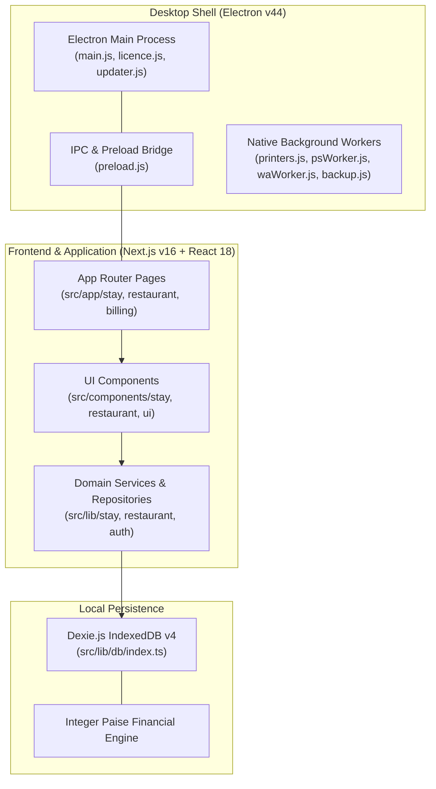

# Kamai Plus Desktop (कमाई प्लस डेस्कटॉप)

> **The Fastest, Offline-First Multi-Vertical Business & Hospitality Operating System for India.**  
> Built for retail shops, restaurants, cafes, lodges, budget hotels, and independent accommodation businesses.

[](https://www.typescriptlang.org/)
[](https://nextjs.org/)
[](https://react.dev/)
[](https://www.electronjs.org/)
[](https://tailwindcss.com/)
[](#license)

---

## 📖 Overview

**Kamai Plus Desktop** is a high-performance Windows desktop application designed to operate reliably with zero internet connectivity. It provides Indian merchant owners with high-speed billing, inventory tracking, financial management, thermal receipt printing, and guest hospitality management.

The platform is designed around the core principle:
> **"कमीत कमी क्लिक्स. कमीत कमी टायपिंग. शून्य गोंधळ. जास्तीत जास्त काम."**  
> *(Minimum clicks. Minimum typing. Zero confusion. Maximum work completed.)*

---

## 🚀 Key Modules & Verticals

### 1. 🏨 Kamai Plus Stay (लॉज आणि हॉटेल व्यवस्थापन)
A complete, streamlined accommodation management module for Indian lodges, budget hotels, and guest houses:
- **Interactive Room Rack:** Visual card grid with live availability status badges (`उपलब्ध`, `पाहुणे आहेत`, `सफाई आवश्यक`, `दुरुस्ती सुरू`).
- **4-Click Quick Walk-in:** Immediate check-in modal completing guest registration and key handover in under **45 seconds**.
- **Hospitality Pickers:** Custom calendar popup (`StayDatePicker`) with 1-click Marathi stay duration presets (`आज`, `उद्या`, `+2 रात्री`) and 12-hour AM/PM time picker (`StayTimePicker`).
- **Integer Paise Folio Ledger:** Complete double-entry hospitality accounting preventing floating-point rounding errors.
- **Dual-Format Receipt Printing:** Instant toggle between standard A4 paper bills and 80mm thermal POS receipt rolls.
- **WhatsApp Integration:** 1-click transmission of bilingual (`mr` & `en`) payment summaries to guests via WhatsApp.
- **Automated Housekeeping Turnover:** Rooms automatically switch to `cleaning` upon guest checkout.
- **Refund Management:** Controlled refund issuance with mandatory audit reasons and official refund receipts.

### 2. 🍽️ Kamai Plus Restaurant (रेस्टॉरंट आणि कॅफे व्यवस्थापन)
- **Table Management:** Visual floor layout with drag, wheel, and touch navigation.
- **Kitchen Order Tickets (KOT):** Instant thermal KOT dispatch to kitchen printers with independent printer assignment.
- **Fast POS Cart:** Compact 44px cart layout with keyboard shortcuts (`F8`, `F9`, `F10`) for split seconds counter billing.
- **Table Status Tracking:** Real-time vacant, occupied, and billed table states.

### 3. 🛒 Retail & Supermarket POS
- High-speed barcode scanning.
- Thermal 80mm and 58mm ESC/POS printer integration (`printers.js`).
- Pre-loaded vertical product catalogs (`Agri`, `Cosmetics`, `Garments`, `Hardware`, `Pharmacy`, `Stationery`).
- Customer ledger, credit management, and WhatsApp billing.

---

## 🏗️ Architecture & Technology Stack



- **Runtime:** Electron `^44.4.3` + Next.js `^16.3.1` (Turbopack).
- **Frontend:** React `^18.3.1`, TypeScript `^5.7.3`, Tailwind CSS `^3.4.17`.
- **Database:** Local IndexedDB via Dexie.js `^4.0.11` with multi-tenant `business_id` scoping.
- **Fonts:** Plus Jakarta Sans & JetBrains Mono offline fonts bundled locally.

---

## 📁 Repository Directory Structure

```text
kamaiplus-desktop/
├── .github/                       # GitHub workflows and issue templates
├── build/                         # Packaging icons and assets (build/icon.ico)
├── data/
│   └── catalogs/                  # Merchant vertical product seed catalogs
├── docs/                          # Comprehensive technical documentation
│   ├── architecture/              # System architecture, DB schema, security
│   ├── stay/                      # Complete Stay lodge management specifications
│   ├── restaurant/                # Restaurant module documentation
│   └── archive/                   # Historical sprint trackers and draft registers
├── scripts/                       # E2E simulation, bump version, and release scripts
├── src/
│   ├── app/                       # Next.js App router pages (stay, restaurant, billing)
│   ├── components/                # React UI components (stay, restaurant, ui)
│   ├── lib/                       # Domain services, Dexie DB schema, financial engine
│   └── locales/                   # Bilingual translations (mr.json, hi.json, en.json)
├── [electron-modules].js          # 14 Electron main process services (main.js, preload.js, etc.)
├── .env.example                   # Sanitized environment template
├── .gitignore                     # Hardened ignore file
├── CHANGELOG.md                   # Formal versioned product changelog
├── CONTRIBUTING.md                # Development standards & guidelines
├── LICENSE                        # Commercial license
├── package.json                   # Dependencies, scripts, and electron-builder configuration
├── package-lock.json              # Deterministic dependency lockfile
├── tsconfig.json                  # Strict TypeScript configuration
└── tailwind.config.js             # Design tokens and theme settings
```

---

## ⚙️ Prerequisites

- **Operating System:** Windows 10 or Windows 11 (64-bit).
- **Node.js:** Node.js v20.x or higher LTS.
- **Package Manager:** `npm` (v10+).

---

## 🛠️ Installation & Setup

1. **Clone the repository:**
   ```powershell
   git clone https://github.com/shubhsnp/kamaiplus-desktop.git
   cd kamaiplus-desktop
   ```

2. **Install dependencies:**
   ```powershell
   npm install
   ```

3. **Configure Environment:**
   Copy `.env.example` to `.env.local` and configure your credentials:
   ```powershell
   cp .env.example .env.local
   ```

4. **Verify TypeScript compilation:**
   ```powershell
   npx tsc --noEmit
   ```

---

## 🏃 Running the Application

### 1. Web Development Server (Browser Mode)
```powershell
npm run dev
```
Open [http://localhost:3000](http://localhost:3000) in your browser.
- **Stay Module:** [http://localhost:3000/stay](http://localhost:3000/stay)
- **Bookings:** [http://localhost:3000/stay/bookings](http://localhost:3000/stay/bookings)
- **Restaurant POS:** [http://localhost:3000/restaurant](http://localhost:3000/restaurant)

### 2. Native Desktop Application (Electron Development)
```powershell
npm run electron
```
Launches the Electron desktop shell with live hot-reloading.

### 3. Build Windows Desktop Installer (.exe)
```powershell
npm run build:desktop
```
Generates the NSIS Windows installer `.exe` in the `dist/` directory.

---

## 📚 Technical Documentation

Detailed documentation is organized in the [`docs/`](docs/) directory:
- [System Architecture](docs/architecture/SYSTEM_ARCHITECTURE.md)
- [Stay Product Requirements](docs/stay/STAY_PRODUCT_REQUIREMENTS.md)
- [Stay Payment & Financial Architecture](docs/stay/STAY_PAYMENT_ARCHITECTURE.md)
- [Stay Receipt Design (A4 & 80mm)](docs/stay/STAY_RECEIPT_DESIGN.md)
- [Stay WhatsApp Integration](docs/stay/STAY_WHATSAPP_INTEGRATION.md)
- [Stay Usability Test Report](docs/stay/STAY_USABILITY_TEST_REPORT.md)
- [Stay Regression Test Report](docs/stay/STAY_REGRESSION_TEST_REPORT.md)

---

## 📄 License

Copyright © 2026 Kamai Plus. All rights reserved.  
Proprietary and confidential commercial software. Unauthorized copying, distribution, or reverse engineering is strictly prohibited. See [LICENSE](LICENSE) for details.
