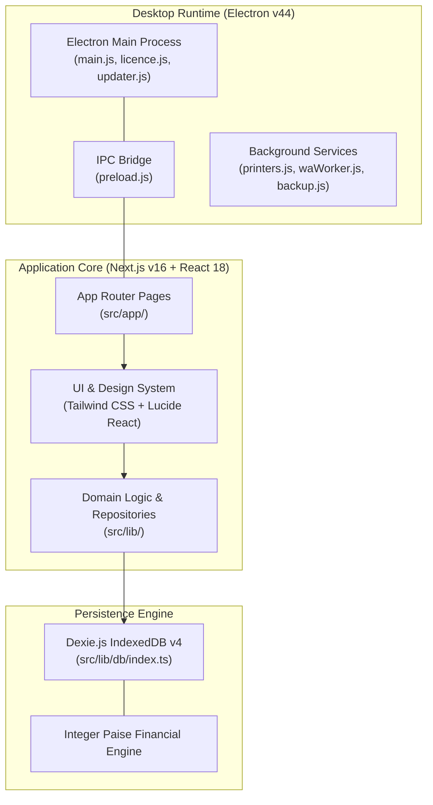

# KAMAI PLUS COMPATIBILITY BLUEPRINT & ARCHITECTURE SPECIFICATION

**Document:** `docs/architecture/kamai-plus-compatibility.md`  
**Author:** CTO & Principal Software Architect  
**Purpose:** Ensure independent Kamai Stay development maintains 100% upstream merge compatibility with the original Kamai Plus platform.  
**Last Updated:** November 2026  

---

## 1. Executive Summary & Upstream Coexistence Strategy

Kamai Stay is being developed as an **independently managed, autonomous hospitality product** using dedicated development infrastructure and the independent GitHub repository:
👉 `https://github.com/shubhsnp/kamaiPlus-desktop`

The original Kamai Plus ecosystem (owned by the upstream maintainer) is a multi-vertical commerce platform supporting Retail POS and Restaurant operations.

To ensure that Kamai Stay can be selectively merged back into the upstream repository via clean Pull Request without merge conflicts or breaking changes:
1. **Strict Modular Isolation:** All Stay business logic, components, repositories, and routes are encapsulated under `src/app/stay/`, `src/components/stay/`, and `src/lib/stay/`.
2. **Zero Incompatible Stack Upgrades:** Stay strictly uses the upstream framework versions (Next.js 16.3, React 18.3, Electron 44.4, Dexie 4.0, TypeScript 5.7).
3. **Explicit Touchpoint Control:** Only 3 upstream shared files are touched by Stay (Sidebar navigation, Dexie schema registration, and localization JSON files).
4. **Independent Cloud & Firebase Separation:** Development runs on an independent Firebase/cloud tenant; no upstream secrets or production data are ever utilized.

---

## 2. Upstream Technology Inventory



### 2.1 Core Runtime & Packaging
* **Framework:** Electron `^44.4.3`
* **Packager:** `electron-builder ^26.15.3` (Target: Windows NSIS installer)
* **Frontend Web Framework:** Next.js `^16.3.1` (App Router, Turbopack)
* **UI Runtime:** React `^18.3.1`, React DOM `^18.3.1`
* **Language:** TypeScript `^5.7.3` (Strict mode)
* **Styling Engine:** Tailwind CSS `^3.4.17`, PostCSS `^8.5.2`, Autoprefixer `^10.4.20`
* **Offline Typography:** Bundled Plus Jakarta Sans & JetBrains Mono fonts

### 2.2 Exact Dependency Inventory (`package.json`)
| Dependency Package | Upstream Version | Role in Ecosystem | Stay Usage Rule |
|---|---|---|---|
| `dexie` | `^4.0.11` | Client-side IndexedDB persistence | Primary data store for all Stay tables |
| `dexie-react-hooks` | `^1.1.7` | Reactive React queries | Live UI reactivity |
| `lucide-react` | `^0.475.0` | UI Icons | Standardized icon library |
| `clsx` & `tailwind-merge`| `^2.1.1` / `^3.0.1` | Class composition | Reusable UI styles |
| `date-fns` | `^4.1.0` | Date manipulation | Used in calendar & stay math |
| `zod` | `^3.24.2` | Schema validation | Stay input validation |
| `jspdf` & `html2canvas` | `^4.2.1` / `^1.4.1` | PDF export | A4 & Thermal bill generation |
| `@whiskeysockets/baileys`| `7.0.0-rc14` | WhatsApp Multi-Device | Background bill dispatch |
| `firebase` | `^12.18.0` | Cloud sync & Hosting | Independent dev project |
| `electron-updater` | `^6.8.9` | Auto-update agent | Preserved untouched |
| `use-debounce` | `^10.1.1` | Search debouncing | Guest phone autocomplete |
| `react-virtuoso` | `^4.18.14` | Virtualized lists | Room rack & booking tables |

---

## 3. Database Architecture & Upstream Isolation

### 3.1 Dexie Database Registration (`src/lib/db/index.ts`)
The upstream database uses Dexie.js versioning. All Stay tables are explicitly segregated:

```typescript
// Upstream Dexie Schema Registration
db.version(VERSION).stores({
  // --- Upstream Core & Restaurant Stores ---
  businesses: 'id, name, created_at',
  orders: 'id, business_id, table_id, status, created_at',
  tables: 'id, business_id, name, status',
  menu_items: 'id, business_id, category_id, name',
  customers: 'id, business_id, phone, name',
  
  // --- Dedicated Stay Stores (Isolated) ---
  rooms: 'id, business_id, room_type_id, number, floor, status, is_active',
  stay_room_types: 'id, business_id, name, code, is_active',
  stay_bookings: 'id, business_id, booking_reference, room_id, room_type_id, primary_guest_id, status, check_in_date, check_out_date',
  stay_guests: 'id, business_id, phone, name',
  stay_folios: 'id, business_id, booking_id, status',
  stay_folio_entries: 'id, business_id, folio_id, entry_type, entry_date',
  stay_payments: 'id, business_id, folio_id, booking_id, payment_method, paid_at',
  stay_housekeeping_tasks: 'id, business_id, room_id, status, assigned_to',
  stay_settings: 'id, business_id'
});
```

### 3.2 Integer Paise Accounting Mandate
- Monetary fields (`base_rate_paise`, `agreed_rate_paise`, `amount_paise`, `grand_total_paise`, `total_paid_paise`, `balance_due_paise`) strictly use **integer paise** (`1 Rupee = 100 Paise`).
- Floats are forbidden in database entities to prevent floating-point rounding divergence.

---

## 4. Upstream Shared Services & Touchpoints

Kamai Stay interacts with only six shared subsystems in the upstream platform:

| Shared Subsystem | File Location | How Stay Integrates | Safety / Isolation Guarantee |
|---|---|---|---|
| **Multi-Tenancy** | `src/components/layout/BusinessProvider.tsx` | Calls `useBusiness()` to retrieve active `businessId` | Read-only access. Never alters business scoping logic. |
| **Localization (i18n)** | `src/lib/i18n/index.tsx` | Calls `useTranslation()` (`mr`, `hi`, `en`) | Read-only. Stay strings are keyed independently under `stay.*`. |
| **UI Primitives** | `src/components/ui/` | Imports `Button`, `Card`, `Input`, `Modal` | Read-only consumption. No modifications to shared UI primitives. |
| **Auth User State** | `src/lib/auth.ts` | Calls `getStoredUser()` for lodge header name | Read-only. Does not touch login/JWT session logic. |
| **Navigation Menu** | `src/components/layout/Sidebar.tsx` | Appends single Stay navigation item | Conditional on `isStayEnabled`. Zero effect on restaurant navigation. |
| **Database Schema** | `src/lib/db/index.ts` | Adds `stay_*` table definitions | Additive table declarations only. Zero modifications to existing tables. |

---

## 5. Firebase & Cloud Coexistence Contract

### 5.1 Upstream Cloud Contract (`docs/CLOUD_DATA_CONTRACT.md`)
* Path structure: `businesses/{bizId}/{collection}/{docId}`
* Tenant identifier: `bizId = 'biz_' + Firebase UID`
* Currency standard: `*_paise` (integer)
* Timestamp standard: ISO 8601 UTC with `Z` suffix

### 5.2 Independent Stay Cloud Firestore Collections
When cloud synchronization is activated for Stay, it maps seamlessly to the existing contract:
- `businesses/{bizId}/stay_rooms/{roomId}`
- `businesses/{bizId}/stay_room_types/{roomTypeId}`
- `businesses/{bizId}/stay_bookings/{bookingId}`
- `businesses/{bizId}/stay_guests/{guestId}`
- `businesses/{bizId}/stay_folios/{folioId}`
- `businesses/{bizId}/stay_payments/{paymentId}`
- `businesses/{bizId}/stay_housekeeping/{taskId}`

### 5.3 Independent Development Firebase Project
- An independent development Firebase project will be created (e.g. `kamai-stay-dev`).
- Development will use isolated Firebase Auth, Firestore, and Hosting instances.
- Upstream credentials (`kamaiplus`) are strictly quarantined and never used during development.

---

## 6. Future Upstream PR & Merging Checklist

When Stay development reaches production readiness and is ready for upstream contribution:
1. [ ] Rebase the independent `feature/stay-module` branch onto latest upstream `upstream/main`.
2. [ ] Verify that no modifications exist outside:
   - `src/app/stay/`
   - `src/components/stay/`
   - `src/lib/stay/`
   - `src/components/layout/Sidebar.tsx` (single navigation item)
   - `src/lib/db/index.ts` (table declarations)
   - `src/locales/{mr,hi,en}.json` (translation keys)
   - `docs/stay/`
3. [ ] Run `npx tsc --noEmit` and confirm `0 errors`.
4. [ ] Run full Restaurant and POS regression tests to prove zero cross-vertical impact.
5. [ ] Open an isolated Pull Request against the upstream repository owner for review.
