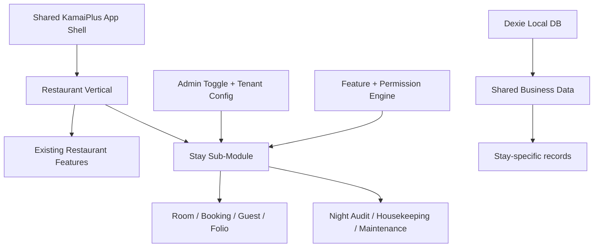

# Kamai Plus Stay Architecture

## Decision
The correct starting architecture is: Stay as a sub-module under the existing Restaurant vertical, not as a standalone top-level app.

This is the best fit for the repository because:
- the repo already has a `restaurant` vertical under the same app shell
- vertical-specific logic is implemented via existing profiles and feature switches
- the admin control layer is already in place
- the app is local-first and vertically configurable

## Proposed module placement
Keep the current app as the single shell and add Stay under the restaurant domain.

Suggested hierarchical relationship:
- KamaiPlus app shell
- Restaurant vertical
  - existing restaurant operations
  - Stay sub-module

## Module responsibilities
Stay should remain isolated from restaurant operations in both data and workflow semantics.

Recommended separation:
- Restaurant uses table, menu, KOT, and order workflows
- Stay uses room, booking, guest, occupancy, rate plan, night-audit, and folio workflows

## Route and navigation strategy
Stay should not be treated as a separate product surface. It should be:
- a child module under restaurant or a carefully namespaced route group
- enabled or disabled by central admin toggle
- hidden from navigation when disabled
- blocked at data access layer when disabled

## Data model strategy
Keep the existing business identity model intact and add Stay-specific objects.

Core concept:
- shared `business_id` or tenant identifier
- Stay tables scoped under the same business context
- explicit `vertical = 'stay'` or `module = 'stay'`

## Proposed tables (Phase 0 design only)
These are planned entities, not implemented code.
- `rooms`
- `room_types`
- `room_tariffs`
- `bookings`
- `booking_guests`
- `stays`
- `stay_charges`
- `stay_payments`
- `check_ins`
- `check_outs`
- `occupancy_history`
- `housekeeping_tasks`
- `room_service_orders`
- `maintenance_requests`
- `lost_and_found`
- `night_audit_sessions`

## Toggle design
Stay must be controlled by the existing admin layer, not by a simple menu hide.

Required behavior:
- admin can enable or disable Stay
- when off: business cannot access Stay routes
- when on: Stay route and module functions become available
- existing restaurant operations remain unaffected
- existing Stay records remain intact when disabled
- when re-enabled, archived or saved data must remain visible

## Security constraints
Stay must be protected by:
- route guard
- permission guard
- business/tenant guard
- module activation guard
- data-access guard

A frontend-only hide is insufficient and must not be considered acceptable.

## Android/Desktop integration consideration
The repository currently indicates app parity through cloud-contract and shared config patterns, not by separate app logic. If Android support is added later, it should respect the same admin toggle and shared business config instead of a separate independent Stay system.

## High-level architecture diagram

## Conclusion
Stay should be a sub-module of Restaurant, controlled by the admin toggle, and isolated through a clear data model and security guard. This architecture is consistent with the current repo and minimizes regression risk.
