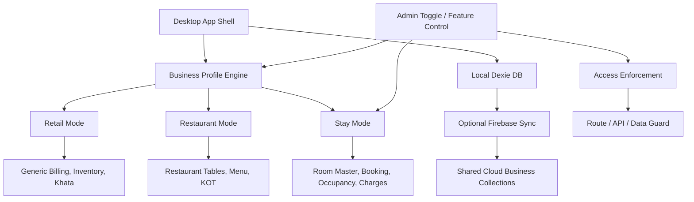

# 05. Proposed Architecture

## Recommendation

Adopt a single-shared-application architecture with a new vertical profile called `stay`. The product should remain one desktop app, but with a separate Stay experience and admin-controlled enablement flag.

This is the closest match to the current codebase because the repo already uses:

- `verticalProfile` to define business category
- `featureSwitches` to surface or hide features
- modular UI folders for business-specific domains
- local-first storage with optional Firebase cloud sync

## High-level architecture

## Architecture principles

### 1. Shared shell, distinct vertical experiences

The app shell should remain shared. The main difference between modes will be:

- route availability
- module set
- vertical-specific objects and flows
- data collection filters
- permission model

### 2. Shared backend model, separate business-domain collections

Keep a single app and single backend model, but create separate Stay collections and stay-specific tables. The base business entity remains shared, and room/booking flows are namespaced under the same shop ID.

### 3. Single admin override for feature activation

The admin system should centrally turn Stay on or off for a business. That configuration should be read by both desktop and mobile/other client surfaces through the same cloud-driven admin control model.

### 4. Central business ID and vertical key

Each business or shop should retain a single `business_id` while adding a `vertical` field (for example `stay`, `restaurant`, `retail`) and a `stay_enabled` boolean or equivalent at the business or admin config level.

## Proposed data flow

### App flow

1. app launches
2. loads business profile and admin feature state
3. checks Stay module enablement
4. loads the Stay page or hides it if disabled
5. if disabled, route guard blocks direct navigation and API access

### Backend flow

1. admin sets feature toggle in central config
2. app fetches config from cloud or admin control
3. app resolves route permissions and module visibility
4. app reads or writes Stay domain collections only if enabled

## Proposed database design

### Shared entities to keep

- `businesses`
- `customers`
- `products` or service catalog items
- `categories`
- `sales`
- `ledger_transactions`
- `cash_registers`
- `cash_expenses`
- `audit_logs`

### New Stay-specific collections

- `rooms`
- `room_types`
- `bookings`
- `booking_guests`
- `check_ins`
- `check_outs`
- `stays`
- `stay_charges`
- `stay_payments`
- `occupancy_history`
- `housekeeping_tasks`
- `room_service_orders`
- `room_tariffs`
- `booking_status_events`

### Recommended relationships

- `businesses` 1:N `rooms`
- `businesses` 1:N `bookings`
- `rooms` 1:N `room_tariffs`
- `bookings` 1:N `stay_charges`
- `bookings` 1:N `stay_payments`
- `bookings` 1:N `occupancy_history`
- `businesses` 1:N `housekeeping_tasks`

## Configuration management design

The existing admin control and feature toggle system is the best fit for the master switch.

Recommended model:

- business-level config: `stay_enabled`, `stay_mode`, `stay_version`
- admin-level override: a forced state for all clients under the business
- read-time enforcement: app checks server or admin config before rendering Stay routes
- cache policy: short-lived local cache, refreshed on app start and config change events

## Security requirements

A menu-hide flag is not enough. Stay must implement all of the following:

- route guard on direct navigation
- backend/API guard on any Stay endpoints
- role-based permission checks for staff and admin
- rejection of access if the business or account is disabled
- safe handling when config changes during an active session

## Operational model

This should remain a local-first app with optional cloud sync, not a pure online app. Room bookings and guest charges must still remain available offline for a short period and then reconcile once sync is available.

## Conclusion

The recommended architecture is a single shared application with a vertical-specific Stay domain and a centrally managed feature toggle. This respects the current codebase’s design philosophy and avoids creating a second product app without evidence.
