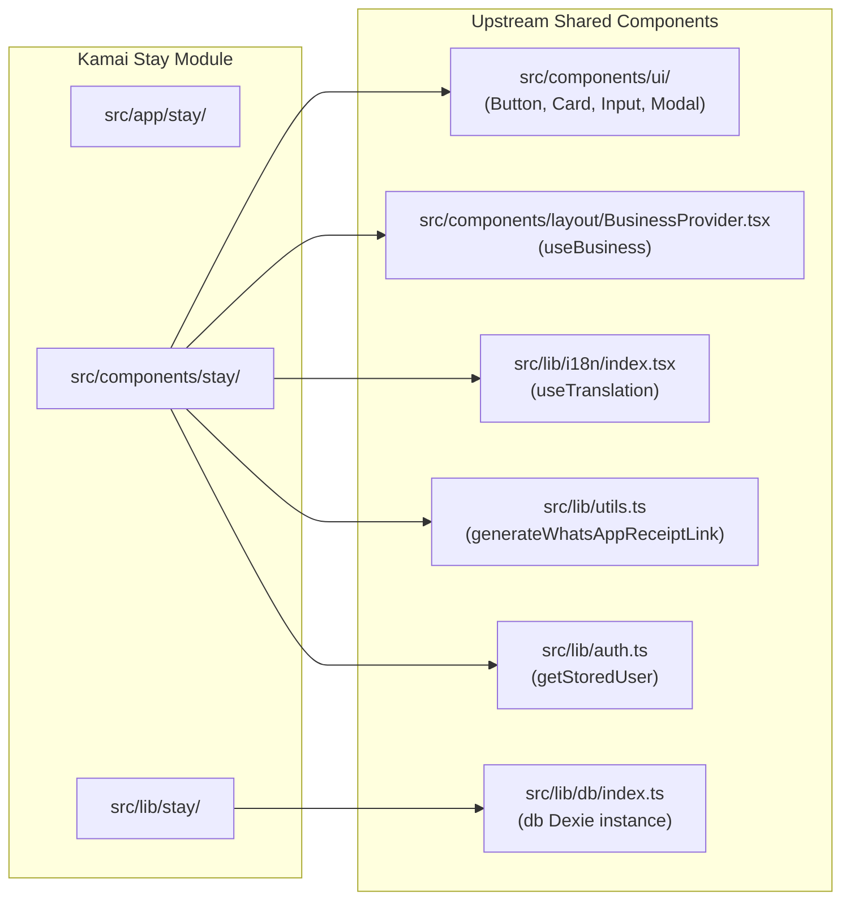

# KAMAI STAY — MODULE DEPENDENCY MAP

**Document:** `docs/integration/stay-dependency-map.md`  
**Purpose:** Comprehensive map of all internal and external dependencies consumed by the Stay module.  
**Last Updated:** November 2026  

---

## 1. Upstream Shared Internal Dependencies

The Stay module consumes the following shared upstream utilities and components:

### Detailed Dependency Table:
| Source File in Stay | Consumed Dependency | Reason for Consumption | Modification to Upstream? |
|---|---|---|---|
| `src/components/stay/**/*.tsx` | `@/components/ui/Button` | Standardized button styling | None (read-only) |
| `src/components/stay/**/*.tsx` | `@/components/ui/Card` | Container card layout | None (read-only) |
| `src/components/stay/**/*.tsx` | `@/components/ui/Input` | Form input styling | None (read-only) |
| `src/components/stay/**/*.tsx` | `@/components/ui/Modal` | Base modal dialog overlay | None (read-only) |
| `src/components/stay/**/*.tsx` | `@/components/layout/BusinessProvider` | Retrieves current `business.id` | None (read-only) |
| `src/components/stay/**/*.tsx` | `@/lib/i18n` | Retrieves `language` & `t()` helper | None (read-only) |
| `src/lib/stay/repositories/*.ts` | `@/lib/db` | Executes Dexie IndexedDB queries | None (reads `db`) |
| `src/components/stay/payments/*.tsx` | `@/lib/utils` | `generateWhatsAppReceiptLink()` | None (read-only) |
| `src/components/stay/payments/*.tsx` | `@/lib/auth` | `getStoredUser()` for shop header | None (read-only) |

---

## 2. External Third-Party Dependencies

Stay strictly utilizes packages already declared in upstream `package.json`:

| Package Name | Upstream Version | How Stay Uses It | Risk Level |
|---|---|---|---|
| `dexie` | `^4.0.11` | Primary local IndexedDB persistence | Very Low (standard Dexie table API) |
| `lucide-react` | `^0.475.0` | UI Icons (BedDouble, Calendar, Printer, etc.) | Very Low (standard React icons) |
| `clsx` & `tailwind-merge` | `^2.1.1` / `^3.0.1` | Dynamic Tailwind class composition | Very Low |
| `date-fns` | `^4.1.0` | Date comparison & night calculations | Very Low |
| `jspdf` & `html2canvas` | `^4.2.1` / `^1.4.1` | PDF receipt generation | Very Low |

**Zero New External Packages:** Stay introduced **0 new npm dependencies**, guaranteeing zero lockfile conflicts upon upstream merge.
