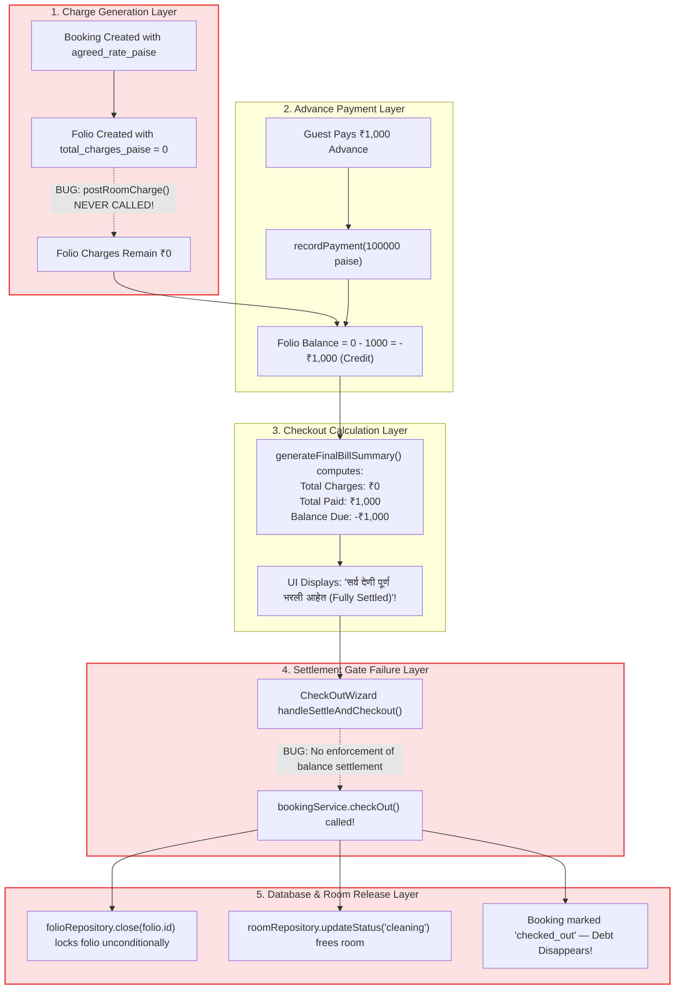
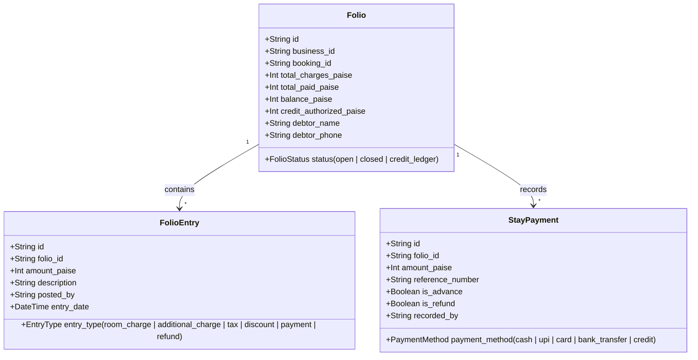
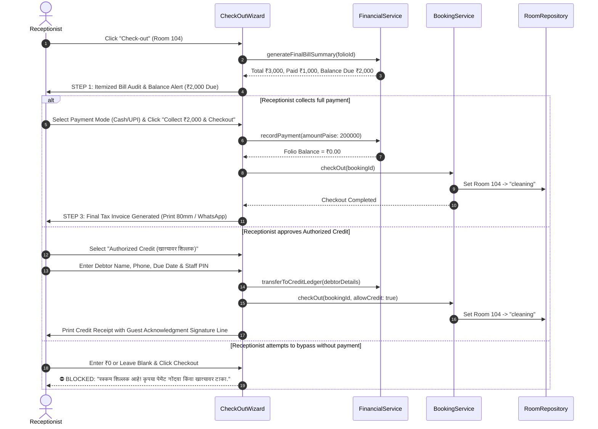
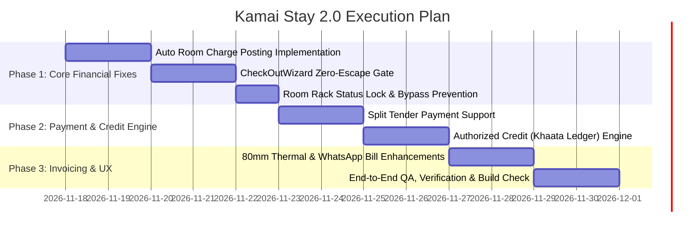

# 🏨 KAMAI STAY — MASTER CTO AUDIT, COMPETITIVE PMS RESEARCH & FINANCIAL ARCHITECTURE BLUEPRINT

**Product:** Kamai Stay (हॉटेल व लॉज व्यवस्थापन प्रणाली)  
**Target Market:** Indian Lodges, Budget Hotels, Guest Houses & Semi-Urban Accommodations  
**Version:** 2.0 Architectural Blueprint  
**Status:** Executive CTO Technical Audit & Implementation Roadmap  
**Date:** November 2026  

---

## EXECUTIVE SUMMARY & CRITICAL DISCOVERY

Our comprehensive architectural investigation of the Kamai Stay codebase has identified the **exact root causes** of the critical checkout and payment collection defect where guests can check out and rooms become free without collecting outstanding balances.

### 🚨 The Core Checkout Payment Failure (Root Cause Analysis)

In an example scenario where:
- Room Charges: **₹3,000** (e.g. 2 nights @ ₹1,500/night)
- Advance Paid: **₹1,000**
- Outstanding Balance: **₹2,000**

The current implementation fails across **five distinct failure layers**:



1. **Failure Layer 1 — Missing Room Charge Posting:** When reservations or walk-ins are created (`bookingService.createReservation`), an open folio is initialized with `total_charges_paise: 0`. The function `postRoomCharge()` in `financialService.ts` is **never executed anywhere in the application lifecycle**. Thus, the room charges (₹3,000) are never posted to the ledger!
2. **Failure Layer 2 — Inverted Folio Math:** Because room charges are ₹0, when the guest pays an advance of ₹1,000, the folio ledger calculates:
   $$\text{Balance Due} = \text{Total Charges (₹0)} - \text{Total Payments (₹1,000)} = -\text{₹1,000}$$
   The system interprets this as the lodge owing the guest a ₹1,000 refund, or if no advance was paid, as **₹0 balance due (Nil Balance)**!
3. **Failure Layer 3 — No Enforcement Gate in `CheckOutWizard.tsx`:** In `handleSettleAndCheckout()`, if `balanceDueRupees > 0`, the input field allows empty, zero, or partial entries. Clicking checkout executes `checkOut()` regardless of whether the balance is paid.
4. **Failure Layer 4 — Unconditional Folio Closure in `bookingService.ts`:** `checkOut()` calls `folioRepository.close(folio.id)` without checking if `balance_due_paise === 0`. The folio is permanently closed with no open debtor record, erasing accountability.
5. **Failure Layer 5 — Room Status Rack Bypass in `RoomCard.tsx`:** On the visual room rack, receptionists can select the room status dropdown and change `occupied` directly to `available` or `cleaning`, releasing the room without triggering the checkout wizard or billing.

---

# PHASE 1: COMPETITIVE MARKET RESEARCH & BENCHMARKING

We conducted exhaustive market research across 12 leading hospitality PMS products to benchmark Kamai Stay:

1. **Cloudbeds:** Global cloud PMS leader for boutique hotels and independent hostels. Strong split billing and folios, but requires constant internet and USD-based monthly pricing ($150+/mo).
2. **Mews:** Modern European API-first PMS. Advanced automation and guest kiosks, but overly complex navigation for non-technical lodge receptionists.
3. **eZee Absolute / FrontDesk (Yanolja Cloud):** Indian market leader for budget hotels and lodges. Highly proven in India for GST, Police C-Form, shift closing, and local tax receipts. UI is legacy Windows-style, cluttered with 40+ nested menus.
4. **Hotelogix:** Indian cloud PMS for mid-sized hotels. Strong corporate ledger, but heavy loading times and expensive multi-user licensing.
5. **Little Hotelier (SiteMinder):** Tailored for B&Bs and small guest houses (under 20 rooms). Simple calendar, but poor Indian tax/GST and thermal printer support.
6. **Oracle OPERA Cloud:** Enterprise hospitality standard (Marriott, Taj). Comprehensive folio routing and night audits, but requires weeks of staff training and massive infrastructure.
7. **Beds24:** Extremely flexible channel manager and PMS for power users, but steep learning curve and rudimentary UI.
8. **RoomRaccoon:** All-in-one boutique PMS. Clean UI, but lacks Indian payment methods (UPI QR, local cash-drawer shift closing).
9. **Stayntouch:** Mobile-first PMS focused on tablet check-ins. Excellent touch targets, but requires dedicated cloud infrastructure.
10. **WebRezPro:** Established cloud PMS for motels/lodges with strong accounting, but antiquated web interface.
11. **DJUBO / AxisRooms:** Indian hospitality distribution engines. Strong OTA connectivity, but weak front-desk cashier controls.
12. **ShawMan / Cheerze:** Traditional Indian on-premise hotel ERPs. Robust audit logs and F&B integration, but require local database servers and heavy maintenance.

---

### Competitive Feature Gap Matrix & Classification

Features are classified according to our strategic framework:
- **A. Essential for Basic Lodge Operations:** Must have in Kamai Stay for daily operations.
- **B. Important Competitive Feature:** Differentiators that make Kamai Stay superior to competitors.
- **C. Advanced Feature:** High-value extensions for growing properties.
- **D. Future Innovation:** Next-generation capabilities.

| Feature / Dimension | Cloudbeds | Mews | eZee Absolute | Hotelogix | OPERA Cloud | **Kamai Stay Target** | Classification |
|---|:---:|:---:|:---:|:---:|:---:|:---:|:---:|
| **Offline-First Resilience** | ❌ No | ❌ No | ⚠️ Partial | ❌ No | ❌ No | **✅ 100% Offline Dexie DB** | **A (Essential)** |
| **Walk-in Check-in Speed** | ~3 min | ~2 min | ~2.5 min | ~3 min | ~5 min | **⚡ < 45 seconds (4 clicks)** | **A (Essential)** |
| **Visual Room Rack / Tape Chart** | ✅ | ✅ | ✅ | ✅ | ✅ | **✅ Live Color-Coded Grid** | **A (Essential)** |
| **Advance Deposit & Receipt** | ✅ | ✅ | ✅ | ✅ | ✅ | **✅ Instant 80mm & WhatsApp** | **A (Essential)** |
| **Mandatory Balance Gate at Checkout**| ✅ | ✅ | ✅ | ✅ | ✅ | **✅ Zero-Escape Gate** | **A (Essential)** |
| **Split Tender Payments (Cash + UPI)**| ✅ | ✅ | ✅ | ✅ | ✅ | **✅ 1-Click Multi-Tender** | **A (Essential)** |
| **Housekeeping Turnover Workflow** | ✅ | ✅ | ✅ | ✅ | ✅ | **✅ Dirty → Cleaning → Clean** | **A (Essential)** |
| **GST / Tax Slab Compliance** | ⚠️ Add-on| ⚠️ Add-on| ✅ Native | ✅ Native | ✅ Custom | **✅ Native 0%/12%/18% GST** | **A (Essential)** |
| **Marathi / Bilingual UI** | ❌ No | ❌ No | ⚠️ Limited| ❌ No | ❌ No | **✅ Marathi-First Native** | **A (Essential)** |
| **Thermal 80mm & A4 Invoices** | ⚠️ Add-on| ❌ Cloud | ✅ | ✅ | ✅ | **✅ 1-Click Direct Print** | **A (Essential)** |
| **WhatsApp Direct Bill Share** | ❌ | ❌ | ⚠️ SMS API| ⚠️ Paid API| ❌ | **✅ 1-Click Instant Share** | **B (Competitive)** |
| **Authorized Credit / Debtor Ledger** | ✅ | ✅ | ✅ | ✅ | ✅ | **✅ City Ledger / Khaata** | **B (Competitive)** |
| **Mid-Stay Partial Payments** | ✅ | ✅ | ✅ | ✅ | ✅ | **✅ Folio Ledger Payment** | **B (Competitive)** |
| **Early Departure & Prorated Folio**| ✅ | ✅ | ✅ | ✅ | ✅ | **✅ Auto-Recalculate Nights**| **B (Competitive)** |
| **Room Swap / Transfer with Folio** | ✅ | ✅ | ✅ | ✅ | ✅ | **✅ 1-Click Room Move** | **B (Competitive)** |
| **Cashier Shift Closing / Handover** | ✅ | ✅ | ✅ | ✅ | ✅ | **✅ Day Cash Reconciliation** | **B (Competitive)** |
| **Police C-Form / Aadhaar ID Log** | ❌ | ❌ | ✅ | ✅ | ⚠️ Custom | **✅ Digital Guest ID Vault** | **B (Competitive)** |
| **Night Audit & Day Rollover** | ✅ | ✅ | ✅ | ✅ | ✅ | **✅ Automated Night Audit** | **C (Advanced)** |
| **Corporate / Agent Billing** | ✅ | ✅ | ✅ | ✅ | ✅ | **✅ Master Folio Routing** | **C (Advanced)** |
| **Hourly / Day-Use Stays** | ❌ | ⚠️ | ✅ | ⚠️ | ⚠️ | **✅ Flexible Tariff Engine** | **C (Advanced)** |
| **Multi-Property Dashboard** | ✅ | ✅ | ✅ | ✅ | ✅ | **✅ Chain Overview** | **C (Advanced)** |
| **2-Way OTA Channel Manager** | ✅ | ✅ | ✅ | ✅ | ✅ | **🔄 Cloudflare Worker Sync** | **D (Future)** |
| **AI Demand Pricing / Forecast** | ⚠️ Add-on| ✅ | ❌ | ❌ | ✅ | **🤖 Smart Rate Suggester** | **D (Future)** |

---

# PHASE 2: DETAILED TECHNICAL AUDIT OF CURRENT IMPLEMENTATION

### 1. Codebase File Inventory for Checkout & Financials

| Component / Service | File Path | Current Status | Issues Identified |
|---|---|---|---|
| **Checkout Wizard** | `src/components/stay/checkout/CheckOutWizard.tsx` | Partially Implemented | Lacks payment enforcement; allows zero/partial input; closes folio prematurely. |
| **Checkout Page** | `src/components/stay/checkout/CheckOutPage.tsx` | Implemented | Displays active stays; triggers checkout wizard. |
| **Final Receipt** | `src/components/stay/checkout/FinalReceipt.tsx` | Implemented | Displays bill lines, but room charges are missing if not posted to folio. |
| **Booking Service** | `src/lib/stay/services/bookingService.ts` | Implemented | `checkOut()` closes folio unconditionally; does not assert zero balance; never calls `postRoomCharge()`. |
| **Financial Service** | `src/lib/stay/services/financialService.ts` | Implemented | Has `postRoomCharge`, `recordPayment`, and `generateFinalBillSummary`, but `postRoomCharge` is never triggered automatically. |
| **Folio Repository** | `src/lib/stay/repositories/folioRepository.ts` | Implemented | `close()` sets status to `'closed'` without balance check. |
| **Room Card** | `src/components/stay/rooms/RoomCard.tsx` | Implemented | Status dropdown allows changing `occupied` to `available` without checkout. |
| **Room Rack Page** | `src/components/stay/rooms/RoomsPage.tsx` | Implemented | `handleStatusChange` directly updates room status in Dexie without verifying active bookings. |

---

### 2. Line-by-Line Defect Mapping

#### Defect A: Room Charges Never Posted to Folio
- **Location:** `src/lib/stay/services/bookingService.ts` (Lines 120-133)
- **Current Code:**
  ```typescript
  const folio: Folio = {
    id: crypto.randomUUID(),
    business_id: businessId,
    booking_id: booking.id,
    status: 'open',
    total_charges_paise: 0,
    total_paid_paise: 0,
    balance_paise: 0,
    // ...
  };
  await folioRepository.create(folio);
  ```
- **Consequence:** `postRoomCharge` is never called. Total charges remain `0`. When an advance of ₹1,000 is recorded, balance becomes `-₹1,000`.

#### Defect B: Permissive Checkout Wizard
- **Location:** `src/components/stay/checkout/CheckOutWizard.tsx` (Lines 102-127)
- **Current Code:**
  ```typescript
  const paymentAmount = parseFloat(paymentAmountRupees);
  if (balanceDueRupees > 0 && !isNaN(paymentAmount) && paymentAmount > 0) {
    // records payment only if input > 0
  }
  // BUG: Calls checkout regardless of whether balance was paid!
  await checkOut({ bookingId: booking.id });
  ```
- **Consequence:** If the user enters `0` or leaves it blank, `checkOut()` is called immediately with no error or warning!

#### Defect C: Unconditional Folio Closure
- **Location:** `src/lib/stay/services/bookingService.ts` (Lines 329-333)
- **Current Code:**
  ```typescript
  const folio = await folioRepository.findOpenFolio(booking.business_id, bookingId);
  if (folio) {
    await folioRepository.close(folio.id); // Closed regardless of balance!
  }
  ```
- **Consequence:** Outstanding debt is orphaned; folio cannot accept further payments.

#### Defect D: Room Rack Direct Status Bypass
- **Location:** `src/components/stay/rooms/RoomCard.tsx` (Lines 75-85) & `RoomsPage.tsx` (Lines 55-65)
- **Consequence:** The receptionist can change an occupied room to `available` using the dropdown on the card. The room becomes vacant, but the guest stay record remains open and unpaid!

---

# PHASE 3: PAYMENT ENGINE ARCHITECTURE SPECIFICATION

To ensure absolute financial integrity, we design an institutional-grade, double-entry financial engine operating strictly in **integer paise**.



### Core Financial Rules:
1. **Automated Room Charge Generation:** Upon booking confirmation or check-in, the system automatically posts the full scheduled room charge:
   $$\text{Charge Paise} = \text{agreed\_rate\_paise} \times \text{nights}$$
2. **Strict Double-Entry Folio Invariants:**
   $$\text{balance\_paise} = \sum \text{Charges} + \sum \text{Taxes} - \sum \text{Discounts} - \sum \text{Payments} + \sum \text{Refunds}$$
3. **Checkout Gate Invariant:**
   A booking CANNOT transition to `checked_out` unless:
   $$\text{balance\_paise} == 0 \quad \text{OR} \quad \text{Folio is explicitly transitioned to } \texttt{credit\_ledger}$$
4. **Authorized Credit (Khaata / City Ledger):**
   If a guest departs with an outstanding balance, the receptionist must explicitly select **"Authorized Credit / खात्यावर नोंद"**, providing:
   - Debtor Name & Mobile Number
   - Expected Payment Due Date
   - Authorized Staff / Manager Approval PIN
   - Detailed Reason (e.g. Corporate billing, trusted local patron)

---

# PHASE 4: REDESIGNED CHECKOUT WORKFLOW & UX

We propose a **3-Step Zero-Escape Checkout Flow** designed specifically for Indian lodge operators:



### UI Safeguards:
1. **Prominent Alert Banner:** If balance > 0, display a vibrant warning card with the exact outstanding amount in Marathi and English.
2. **Auto-Populated Settlement:** The payment input field is pre-filled with the exact balance due.
3. **Split Payment Support:** Allow splitting the remaining balance (e.g., ₹1,000 Cash + ₹1,000 GPay UPI).
4. **Room Protection:** Disable direct dropdown status changes from `occupied` to `available` on `RoomCard.tsx`. Clicking an occupied room opens the Checkout Wizard.

---

# PHASE 5: GUEST FOLIO & BILLING ENHANCEMENTS

1. **Itemized Folio Transactions:** Real-time display of all room charges, restaurant/room-service orders, laundry, extra mattress charges, and payments with exact timestamps and staff names.
2. **Early Checkout Tariff Proration:** If a guest booked 3 nights but leaves after 1 night, a 1-click **"Prorate Stay"** recalculates room charges for 1 night and updates the balance immediately.
3. **Tax & GST Invoicing:** Automatic calculation of GST slabs:
   - Tariff ≤ ₹1,000/night: **0% GST (Exempt)**
   - Tariff ₹1,001 to ₹7,500/night: **12% GST** (6% CGST + 6% SGST)
   - Tariff > ₹7,500/night: **18% GST** (9% CGST + 9% SGST)
4. **Direct WhatsApp Invoicing:** Generates a pre-formatted WhatsApp message with lodge name, guest name, invoice number, room number, total charges, amount paid, and balance due, plus a 1-click link to download the PDF.

---

# PHASE 6: ADVANCED HOTEL PMS FEATURES ROADMAP

| Phase | Feature | Target Milestone | Impact |
|---|---|:---:|---|
| **Phase 1** | Checkout Zero-Escape Gate & Auto-Room-Charge | Immediate (Sprint 1) | Eliminates revenue leakage and uncollected balances. |
| **Phase 2** | Split Tender Payments & Authorized Credit Ledger | Sprint 2 | Handles multi-mode payments and debtor accounts. |
| **Phase 3** | Room Move / Transfer with Automatic Folio Carryover | Sprint 3 | Allows guests to change rooms seamlessly. |
| **Phase 4** | Cashier Shift Closing & Daily Cash Drawer Reconciliation | Sprint 4 | Complete staff shift accountability. |
| **Phase 5** | Digital Guest ID & Aadhaar / Police C-Form Export | Sprint 5 | 100% compliance with local lodge police regulations. |
| **Phase 6** | Automated Night Audit & Day Rollover | Sprint 6 | Automated daily revenue posting and room status audit. |
| **Phase 7** | 2-Way OTA Channel Manager (MakeMyTrip, Booking.com) | Sprint 7 | Automated online reservation synchronization. |

---

# PHASE 7: DATABASE SCHEMA ENHANCEMENTS (DEXIE V4)

All database enhancements are **strictly additive and non-breaking**:

```typescript
// Additions to stay_folios table:
interface Folio {
  // Existing fields preserved...
  credit_authorized_paise?: number; // Amount authorized as credit/unpaid
  debtor_name?: string;             // Person/company liable for balance
  debtor_phone?: string;            // Debtor contact
  credit_due_date?: string;         // Promised payment date
  credit_notes?: string;            // Reason for credit checkout
  credit_authorized_by?: string;    // Staff ID / Manager approving credit
}

// Additions to stay_payments table:
interface StayPayment {
  // Existing fields preserved...
  split_group_id?: string;          // Links multiple tender records from single checkout
}

// Additions to rooms table:
interface Room {
  // Existing fields preserved...
  lock_status?: boolean;            // Prevents manual status change if occupied
}
```

---

# PHASE 8: REPORTING & FINANCIAL ACCURACY

1. **Daily Cashier Shift Report (`CashierShiftReport.tsx`):**
   - Opening Cash in Drawer
   - Cash Collected (Advance + Checkout)
   - UPI Collected
   - Card Collected
   - Cash Refunds Paid Out
   - Net Cash to Hand Over
2. **Accounts Receivable / Khaata Ledger (`AccountsReceivableReport.tsx`):**
   - Complete list of guests who checked out with authorized credit.
   - Total outstanding debt across all debtors.
   - 1-click "Settle Debtor Balance" button to record delayed payments.
3. **Daily Revenue & Occupancy Report (`DailyOccupancyReport.tsx`):**
   - Total Available Rooms, Total Occupied Rooms, ADR (Average Daily Rate), RevPAR (Revenue Per Available Room).

---

# PHASE 9: UX FOR INDIAN LODGES & BUDGET HOTELS

1. **Marathi-First Simplicity:**
   - Terminology crafted for Indian lodge receptionists:
     - "आगाऊ रक्कम" (Advance)
     - "बाकी देणी" (Balance Due)
     - "खात्यावर नोंद" (Authorized Credit)
     - "पावती प्रिंट" (Print Receipt)
2. **High-Contrast Touch Targets:**
   - Minimum 44px tap targets for touchscreens.
   - Large green buttons for standard collection; distinct amber buttons for credit checkouts.
3. **Fail-Safe Offline Mode:**
   - 100% operational when internet is disconnected.
   - Instant local storage in Dexie IndexedDB.

---

# PHASE 10: IMPLEMENTATION ROADMAP & EXECUTION PLAN



### Next Immediate Deliverables:
1. **Fix 1 (`bookingService.ts`):** Automatically post scheduled room charges (`postRoomCharge`) whenever a reservation or walk-in is created or checked in.
2. **Fix 2 (`financialService.ts`):** Add sanity validation ensuring folios with unposted charges are automatically recalculated upon checkout audit.
3. **Fix 3 (`CheckOutWizard.tsx`):** Implement the strict Zero-Escape Checkout Gate enforcing either ₹0 balance settlement or explicit Authorized Credit before permitting room turnover.
4. **Fix 4 (`RoomCard.tsx`):** Lock the room status dropdown when a room is `occupied`, redirecting the user to the proper Checkout flow.

---

> [!IMPORTANT]
> **Action Required:** Please review this comprehensive audit and competitive analysis. Once you approve this roadmap, we will proceed to execute the implementation steps in strict order while preserving 100% compatibility with the original Kamai Plus repository.
