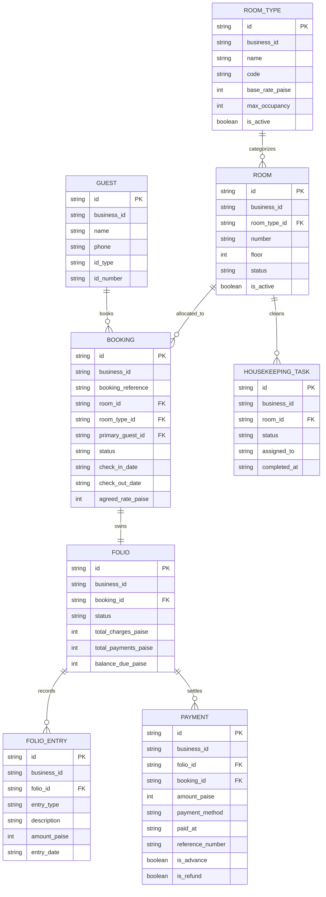

# KAMAI PLUS STAY — DATABASE DESIGN & SCHEMA SPECIFICATION

**Product:** Kamai Plus Stay  
**Version:** 1.2.0  
**Authority:** Database Architect & Principal Systems Engineer  
**Database Engine:** IndexedDB (via Dexie.js v4)  
**Schema File:** `src/lib/db/index.ts`  
**Last Updated:** November 2026  

---

## 1. Entity-Relationship Overview



---

## 2. Table Index Definitions

```typescript
// Dexie store indices (defined in src/lib/db/index.ts)
rooms: 'id, business_id, room_type_id, number, floor, status, is_active',
stay_room_types: 'id, business_id, name, code, is_active',
stay_bookings: 'id, business_id, booking_reference, room_id, room_type_id, primary_guest_id, status, check_in_date, check_out_date',
stay_guests: 'id, business_id, phone, name',
stay_folios: 'id, business_id, booking_id, status',
stay_folio_entries: 'id, business_id, folio_id, entry_type, entry_date',
stay_payments: 'id, business_id, folio_id, booking_id, payment_method, paid_at',
stay_housekeeping_tasks: 'id, business_id, room_id, status, assigned_to',
stay_settings: 'id, business_id'
```

---

## 3. Data Integrity & Sync Protocols

1. **Integer Currency Rule:**
   No floating-point numbers are permitted in any monetary field (`*_paise`).
2. **Offline-First Resilience:**
   Every record includes `sync_status: 'pending' | 'synced'` and ISO timestamps (`created_at`, `updated_at`).
3. **Tenant Boundary:**
   All queries query through compound indices with `business_id` prefix to guarantee complete data isolation between properties.
