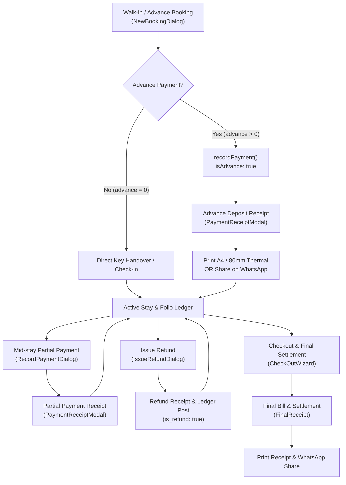

# KAMAI PLUS STAY — PAYMENT & FINANCIAL ARCHITECTURE

**Product:** Kamai Plus Stay (लॉज आणि हॉटेल व्यवस्थापन प्रणाली)  
**Version:** 1.2.0 (CTO Master Standard)  
**Authority:** Permanent CTO & Financial Systems Architect  
**Last Updated:** November 2026  

---

## 1. Financial Architecture Principles

1. **Integer Paise Precision:**
   All monetary amounts are stored and calculated strictly as **integer paise** (`1 Rupee = 100 Paise`).
   - Standard category rate: `120000` paise (₹1,200.00)
   - Advance collected: `100000` paise (₹1,000.00)
   - Balance due: `20000` paise (₹200.00)
   Floating-point arithmetic (`0.1 + 0.2`) is forbidden in database storage and financial ledgers. User inputs and displays are converted at the UI boundary.

2. **Source of Truth — The Guest Folio:**
   The `stay_folios` and `stay_folio_entries` tables serve as the immutable double-entry ledger for each booking.
   - Debits (Charges): Room tariff, extra guest charges, amenities, taxes.
   - Credits (Payments/Adjustments): Advance deposits, mid-stay payments, checkout settlements, discounts, and refunds.

3. **Immutable Payment History:**
   Payments in `stay_payments` are never overwritten or deleted.
   - Multiple partial payments are supported against a single stay.
   - Refunds are recorded as explicit credit adjustments with `is_refund: true` and a negative impact on total paid.

---

## 2. Complete Payment Workflows

---

## 3. Supported Payment Methods

The system supports the following payment methods (`PaymentMethod`):
1. **Cash (`cash`):** Physical cash tender. No transaction reference required.
2. **UPI (`upi`):** Instant QR/UPI payment. Mandatory/recommended UPI Reference ID (UTR / Transaction ID).
3. **Card (`card`):** Credit or Debit card terminal swipe/tap. Card auth code or last 4 digits stored in `reference_number`.
4. **Bank Transfer (`bank_transfer`):** NEFT / RTGS / IMPS deposit with bank transaction reference.
5. **OTA Collect (`ota_collect`):** Paid via Online Travel Agent platform (MakeMyTrip, Booking.com, Goibibo).

---

## 4. Refund Architecture

When a guest leaves early or an overpayment occurs:
1. **Constraint Check:** The refund amount cannot exceed total payments previously collected (`totalPaidPaise`).
2. **Audit Requirement:** The operator must provide a mandatory reason (`Guest departed early`, `Overpayment adjustment`, etc.).
3. **Ledger Posting:** An entry is appended to `stay_folio_entries` with `entry_type: 'refund'` and negative amount.
4. **Payment Record:** A `StayPayment` record is created with `is_refund: true`, linking to the original folio.
5. **Refund Receipt:** An official `REC-XXXXXXXX` refund receipt is generated for customer records and tax audit.

---

## 5. Daily Collection & Reconciliation

Reports (`DailyCollectionReport.tsx`) mathematically reconcile collections:
$$\text{Total Daily Net Collection} = \sum \text{Cash} + \sum \text{UPI} + \sum \text{Card} + \sum \text{Bank Transfer} - \sum \text{Refunds}$$

Every transaction displays:
- Exact ISO timestamp (`paid_at`)
- Transaction Reference Number (`reference_number`)
- Payment Method
- Recorded By / User
- Reconciled against active Folios and room occupancies.
