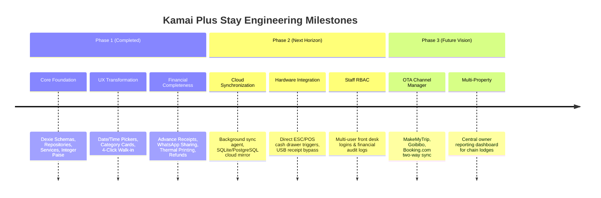

# KAMAI PLUS STAY — MASTER PRODUCT & ENGINEERING ROADMAP

**Product:** Kamai Plus Stay (लॉज आणि हॉटेल व्यवस्थापन प्रणाली)  
**Authority:** Permanent CTO & Principal Product Architect  
**Last Updated:** November 2026  

---

## 1. Roadmap Overview

---

## 2. Phase-by-Phase Roadmap

### Phase 1 — Local Desktop Excellence (Current Milestone: 100% Complete)
- [x] Full offline-first operation on Windows desktop with Dexie IndexedDB.
- [x] Room Category visual cards with live availability badges and auto-seed.
- [x] Smart calendar date picker (`StayDatePicker`) and 12-hour time picker (`StayTimePicker`).
- [x] Single-modal 4-click walk-in check-in (< 45s execution).
- [x] 2-step checkout review & bill settlement.
- [x] Integer paise double-entry Folio ledger.
- [x] Advance deposit receipts, partial payment receipts, and refund receipts.
- [x] Dual-format printing (Standard A4 and 80mm POS Thermal).
- [x] WhatsApp click-to-chat receipt transmission with Marathi/English templates.
- [x] Housekeeping board with automated handoff on checkout.
- [x] Daily collection reconciliation reports.
- [x] 100% zero-regression guarantee on Restaurant module.

### Phase 2 — Cloud Sync, Hardware & Multi-User RBAC (Planned)
- [ ] **Cloud Backend Synchronization:** Background sync worker pushing pending records (`sync_status: 'pending'`) to Kamai Plus cloud API.
- [ ] **Android Companion Tablet/Mobile App:** Receptionist and housekeeping mobile companion app with barcode/QR scanning.
- [ ] **Hardware Native Integrations:** Direct ESC/POS serial/USB cash drawer kick triggers via Electron IPC.
- [ ] **Multi-User Staff Permissions:** Role-based access control (Manager, Receptionist, Auditor, Housekeeper) preventing unauthorized tariff overrides or unapproved refunds.
- [ ] **Document Scanning (OCR):** Camera/webcam capture of guest Aadhaar card / Driving License for police C-Form compliance.

### Phase 3 — Channel Manager & Enterprise Hospitality (Future)
- [ ] **OTA Two-Way Channel Manager:** Real-time inventory sync with MakeMyTrip, Agoda, Booking.com to prevent double bookings.
- [ ] **Automated WhatsApp Cloud API:** Server-side WhatsApp delivery of signed PDF receipts directly to guest phones via Meta WhatsApp Business Platform.
- [ ] **Multi-Property Group Dashboard:** Centralized revenue and occupancy analytics for owners operating multiple lodges.
