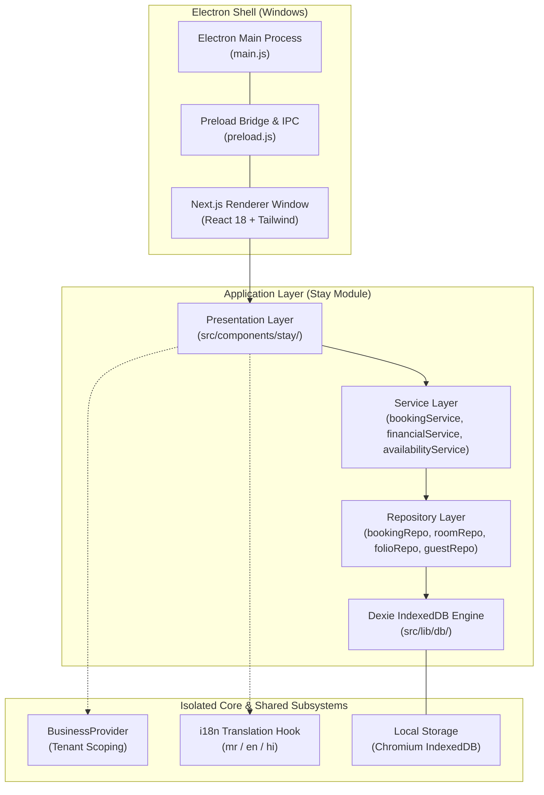

# KAMAI PLUS STAY — SYSTEM ARCHITECTURE SPECIFICATION

**Product:** Kamai Plus Stay  
**Version:** 1.2.0  
**Authority:** Principal Software Architect & CTO  
**Last Updated:** November 2026  

---

## 1. Architectural Overview

Kamai Plus Stay is engineered as an enterprise-grade, offline-first desktop application packaged inside Electron with a Next.js (Turbopack) and React 18 client architecture.

---

## 2. Layered Architecture Principles

### 2.1 Presentation Layer (`src/components/stay/`)
- Pure React functional components with TypeScript strict mode.
- Reusable UI elements (`StayDatePicker`, `StayTimePicker`, `RoomCategorySelector`, `StayStatusBadge`).
- No direct database writes inside UI views; all data operations route through domain services and repositories.

### 2.2 Domain Service Layer (`src/lib/stay/services/`)
- Encapsulates business logic:
  - `bookingService.ts`: Reservation creation, room assignment, walk-in check-in.
  - `availabilityService.ts`: Room conflict checking, night counts, category vacancy.
  - `financialService.ts`: Folio charge posting, tax computations, payment settlement, refund processing, final bill summary.

### 2.3 Repository Layer (`src/lib/stay/repositories/`)
- Abstraction over IndexedDB storage providing typed CRUD operations:
  - `bookingRepository.ts`
  - `roomRepository.ts`
  - `roomTypeRepository.ts`
  - `guestRepository.ts`
  - `folioRepository.ts`

### 2.4 Persistence Layer (`src/lib/db/index.ts`)
- IndexedDB via Dexie.js.
- Clean separation between `stay_*` tables and Restaurant tables (`orders`, `tables`, `menu_items`).

---

## 3. Module Coexistence with Restaurant Vertical

1. **Independent State & Routes:**
   - Restaurant operates under `/restaurant/*`.
   - Stay operates under `/stay/*`.
2. **Zero Cross-Vertical Pollution:**
   - Checking in a guest does not touch dining tables or KOT tickets.
   - Database schema versions are backward-compatible.
3. **Multi-Tenancy:**
   - All queries filter strictly by `business_id` through `BusinessProvider`.
