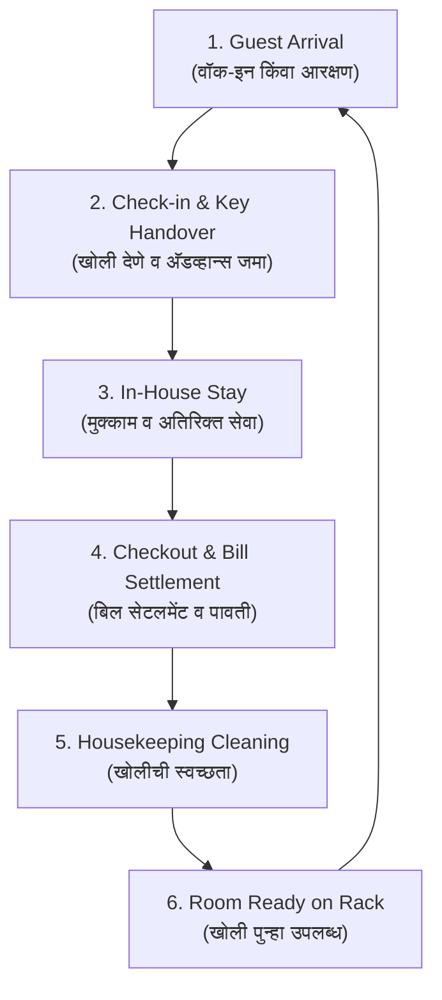

# KAMAI PLUS STAY — HOSPITALITY OPERATIONAL WORKFLOWS

**Product:** Kamai Plus Stay  
**Version:** 1.2.0  
**Authority:** Hospitality Operations Consultant & Lead Architect  
**Last Updated:** November 2026  

---

## 1. The Continuous Lodge Operations Cycle

In a busy Indian lodge or hotel, operations flow continuously between front desk and housekeeping without departmental boundaries:

---

## 2. Detailed Workflows

### 2.1 Walk-in Guest Workflow (Quick Check-in)
* **Frequency:** 70–80% of daily business in Indian lodges.
* **Target Duration:** < 45 seconds.
* **Steps:**
  1. Receptionist clicks `+ त्वरित चेक-इन` or available room card `+ चेक-इन`.
  2. Dialog opens with category cards pre-selected and rate loaded.
  3. Receptionist enters guest 10-digit mobile number (returning guest details auto-fill).
  4. Selects stay duration using 1-click presets (`आज` to `उद्या` or `+2 रात्री`).
  5. (Optional) Enters advance payment amount and method (`Cash` / `UPI` with UTR).
  6. Clicks **"चेक-इन पूर्ण करा"**.
  7. If advance was collected, **Advance Deposit Receipt** displays for immediate printing or WhatsApp sharing. Room turns red (`Occupied`).

### 2.2 Advance Reservation Workflow
* **Frequency:** Pre-booked rooms for family functions, tours, or business trips.
* **Steps:**
  1. Operator toggles modal mode to **"अ‍ॅडव्हान्स आरक्षण"**.
  2. Selects future check-in and check-out dates.
  3. Selects room category (room number assignment can be deferred to arrival).
  4. Collects optional booking advance deposit via UPI/Bank transfer.
  5. Generates advance booking receipt; shares via WhatsApp with guest.
  6. Booking appears on the **Arrivals** tab on check-in day.

### 2.3 Folio & Stay Management
* **Steps:**
  1. Extra services (extra bed, food, laundry) added directly via `खर्च जोडा (Add Charge)` in `FolioView`.
  2. Mid-stay payments recorded via `पेमेंट जमा करा (Record Payment)`.
  3. Each payment row features 1-click **Receipt Print** and **WhatsApp Share** actions.
  4. Early departures or adjustments handled via `रिफंड / परतावा (Issue Refund)`.

### 2.4 Checkout & Bill Settlement Workflow
* **Target Duration:** < 30 seconds.
* **Steps:**
  1. Receptionist clicks **"बिल व चेक-आउट"** on room card or departures list.
  2. Reviews itemized charges and payments.
  3. If outstanding balance remains, selects payment mode (`Cash`, `UPI`, `Card`) and records final settlement.
  4. Clicks **"चेक-आउट पूर्ण करा"**.
  5. Official Checkout Bill displays with dual-format toggle (A4 / 80mm thermal) and WhatsApp sharing.
  6. Room status automatically switches to `cleaning` and appears on the Housekeeping Board.

### 2.5 Housekeeping Turnover Workflow
* **Steps:**
  1. Room appears in Amber (`सफाई आवश्यक`).
  2. Housekeeper clicks **"सफाई सुरू करा (Start Cleaning)"** -> status changes to `in_progress`.
  3. Once clean, clicks **"सफाई पूर्ण झाली (Mark Cleaned)"** -> status changes to `available` (Green).
  4. Room is instantly available for next guest on the Room Rack.
